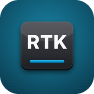

  

<h1 align="center">RetroType Keyboard</h1>

  The typing you remember from classic keyboard phones, rebuilt for today's Android phones. 
  Made by one guy at <a href="https://www.youtube.com/@ReturningRetro">Returning Retro</a>.

  <b>🚫 No internet access &nbsp;·&nbsp; 🚫 No ads &nbsp;·&nbsp; 🚫 No tracking &nbsp;·&nbsp; 🚫 No account</b> 
  The app never even asks Android for internet access. What you type stays on your phone.

  <a href="https://github.com/ReturningRetro/RetroType/releases/latest"><b>⬇️ Download RetroType (free)</b></a>
  &nbsp;&nbsp;|&nbsp;&nbsp;
  <a href="https://retrotype.app/keyholder"><b>🔑 Become a Keyholder</b></a>

---

## Hi, I'm Retro Jake! 

RetroType is an input method editor (aka a keyboard app) for Android phones with physical keyboards/keypads, plus its own on-screen keyboard for any Android phone. It's just me working on it, in my spare time, with help from a small group of very patient testers.

I've been typing on keypads and keyboards since high school. My first phone was a push-to-talk flip phone so my boss (at the local movie theater!) could reach me. A year later, in 2006, I got my first QWERTY phone, and I've been hooked on physical keyboards ever since. I used the great ones back in their day, and I'm using the new wave of keyboard phones now.

Physical keyboards went from being the standard on phones to a clunky mix of hardware and software today, and when a prototype QWERTY phone landed on my desk with no keyboard tuning at all, I decided to try making my own.

### How it's made (honestly)

I'm not a programmer. I build RetroType with an AI coding assistant (an LLM), which writes the code while I steer. What I bring is the part that's hard to find: years of having used these phones back then, AND using the new devices today. I know how they're supposed to feel, I test every build on real phones, and I keep at it until it feels right.

RetroType is built from scratch around that experience. It isn't a copy or a fork of another keyboard app and with it turning out out better than I ever expected (like, a lot better) for that prototype I added more phones and decided to share it with the world!

## Download

1. Go to the **[latest release](https://github.com/ReturningRetro/RetroType/releases/latest)** and tap the `.apk` file to download it.
2. Open the downloaded file. If your phone asks, allow your browser or file manager to install apps.
3. Open **RetroType** and follow the short setup. It walks you through turning the keyboard on.

That's it. No account or sign-up required.

> **About the install warnings:** Android shows a warning for any app that doesn't come from the Play Store. RetroType is registered with Google's developer verification, and since it has no internet access, it can't send anything anywhere.

### Get notified about updates

RetroType never goes online, so it can't check for updates itself. Two easy options:

- **[Obtainium](https://github.com/ImranR98/Obtainium):** add this page's link (`https://github.com/ReturningRetro/RetroType`) and it'll tell you when there's a new version.
- **Email:** sign up at **[retrotype.app](https://retrotype.app)** and I'll let you know.

## Supported phones

RetroType is tuned for:

- Clicks keyboard cases (Pixel 9 & Razr)
- Dumber Mini
- Minimal Phone
- P26
- Q25
- Sidephone (Compact QWERTY tile)
- Titan 2 Elite

It also works on **any Android phone** with its own on-screen keyboard. Android 12 or newer.

### Which phone is next? Keyholders decide 🔑

Adding a phone takes real time (and usually buying one to test on), so Keyholders vote on which phone gets support next. If you'd love RetroType tuned for your phone, becoming a Keyholder is the best way to make it happen.

## Free vs Keyholder

RetroType is free, and the free version is the full keyboard. Keyholders get a few extras as a thank-you for keeping the project going.

| | Free | Keyholder |
|---|:---:|:---:|
| Every typing feature | ✅ | ✅ |
| Every supported phone | ✅ | ✅ |
| No ads, no tracking, no internet access | ✅ | ✅ |
| The Modern theme | ✅ | ✅ |
| More themes and a custom accent colour | | ✅ |
| Extra key sounds | | ✅ |
| Alternate app icons | | ✅ |
| New versions a week early | | ✅ |
| Your name on the About page (if you want) | | ✅ |
| A vote on the next phone and features | | ✅ |

**What does it cost?** Whatever you want, as long as it's at least $10. Once, not a subscription. Anything above $10 goes straight into test phones, new features and keeping the lights on.

<a href="https://retrotype.app/keyholder"><b> Become a Keyholder</b></a>

## Privacy

RetroType doesn't have internet access. That's not a setting you could switch on; the app simply never asks Android for it. No ads, no tracking, no analytics, no data collection, no account. What you type stays on your phone.

## Help and feedback

- **Found a bug or have an idea?** [Open an issue](https://github.com/ReturningRetro/RetroType/issues/new/choose). A short form asks which phone you're on, which makes fixing things much faster.
- **Something private?** Email [retrotype@returningretro.com](mailto:retrotype@returningretro.com).
- **Hang out:** [r/ReturningRetro](https://www.reddit.com/r/ReturningRetro) and [Returning Retro on YouTube](https://www.youtube.com/@ReturningRetro).

I read everything, but it's just me, so please be patient if I'm slow to reply.

## The small print

RetroType is free to download and use. Please don't re-upload, repackage or sell it; send people here instead, so they always get the real, latest version. The app's code isn't public.

RetroType Keyboard is made by Retro Jake at Returning Retro. It isn't affiliated with or endorsed by any phone maker, and phone names are used only to say which phones it works with.

Thanks for checking it out. 🙂
 Retro Jake
